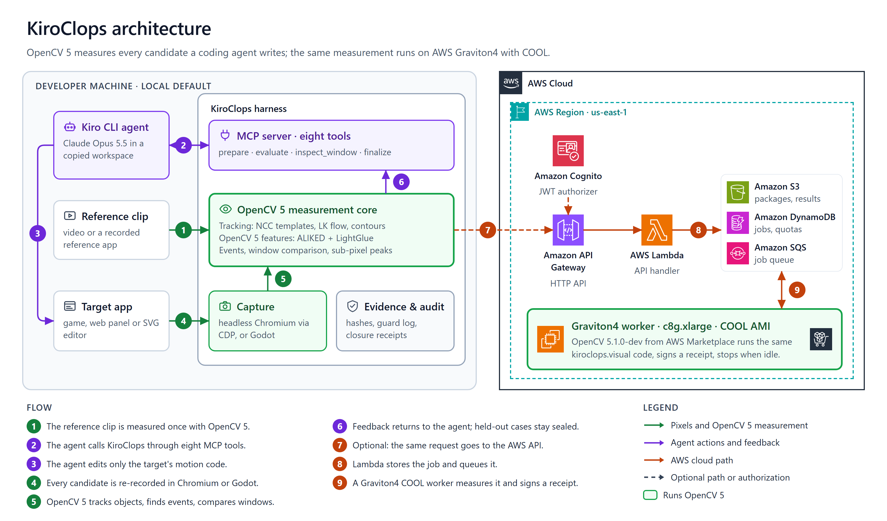

# KiroClops

**Show the behaviour you want in a video; let a coding agent implement it; measure whether the rendered result really matches.**

KiroClops is an OpenCV 5 measurement harness for an AI coding agent (Kiro CLI). It turns a reference recording of a game character, a web panel animation or an SVG diagram into pixel-measured motion, exposes that measurement to the agent through eight MCP tools while the agent edits the real application code, re-records every candidate the agent submits, and decides pass/fail against frozen, pre-registered thresholds. Held-out recordings are revealed only after the agent seals a candidate. Every run leaves a hash-bound evidence chain (sources, frames, measurements, native tool-call audit) that a reviewer who never saw the production coordinates can replay.

Entered in the OpenCV AI Competition 2026 (powered by AWS). Technical report: [`submission/TECHNICAL_REPORT.md`](submission/TECHNICAL_REPORT.md). Engineering history: [`docs/history/README.md`](docs/history/README.md).

## For judges: three checks in ten minutes

1. **Read the summary** of the [technical report](submission/TECHNICAL_REPORT.md): the results, what did not work, and a reading guide mapped to the judging criteria.
2. **Measure on the live AWS service** (about five minutes): follow [`submission/JUDGE_ACCESS.md`](submission/JUDGE_ACCESS.md) with the accounts from the Devpost testing instructions. The receipt shows OpenCV 5.1.0-dev from the COOL image on Graviton4, and `--compare-local` checks the result against your local OpenCV 5.
3. **Replay the agent session** in the browser: the [session replay](https://tritonsan.github.io/kiroclops/replay/) shows one logged Kiro session in which OpenCV 5 measurements changed the agent's next steps. The same evidence in text form is in [`submission/AGENTIC_VISION.md`](submission/AGENTIC_VISION.md).

## What is verified today

| Domain | Target | Status (frozen evidence) |
|---|---|---|
| Game (Godot, Heart) | jump and ground motion transferred from a Tiny Crate reference | **Accepted** (V4 closure `v4g01-closure-02`): behaviour 48/48 regression, 30/30 validation; independent raw review, source review and native audit pass |
| SVG diagram | node add/remove and drag re-layout with connector attachment | **Accepted** (V5b closure `v5s01c-closure-01`): numeric, raw-review, source and native axes pass |
| Web panel | spring open/close/interrupt/drag animation | **Not accepted**: best run (V6 demonstration `v6p01`) passed 55 of 56 held-out cases with one drag-release regression; native audit uncertified for kiro-cli 2.31; earlier V4/V5/V5b runs failed |

Failures are reported as recorded; thresholds were never relaxed and no run was replaced by a rerun.

## How it works



The agent loop in detail: [`submission/diagrams/agent-loop.png`](submission/diagrams/agent-loop.png). Technical report: [`submission/TECHNICAL_REPORT.md`](submission/TECHNICAL_REPORT.md).

* **Measurement** (`kiroclops/visual`): normalised cross-correlation template tracking with mirror/quarter-turn variants and colour gates, Lucas-Kanade flow with RANSAC similarity, Canny/contour geometry, ring-aware SVG connector endpoints, event detection (departure, rest, reversal, overshoot, attachment) and windowed comparison. V6 adds an OpenCV 5 runtime gate, opt-in sub-pixel peak refinement (`upsampled_v1`) and learned local features (`cv2.ALIKED` + `cv2.LightGlueMatcher`, OpenCV 5 `features` module) for scale/rotation-tolerant location and cross-checks.
* **Capture** (`kiroclops/web_local`, `adapters/`): frames are taken through the Chrome DevTools Protocol with host and page clocks bound per frame; game frames come from a Godot adapter at a fixed physics rate. A capture that misses its 120 ms command deadline is re-recorded from the same sealed sources (V6), and every attempt is kept.
* **Agent loop** (`kiroclops/local_engine`): `inspect_session`, `prepare_experiment`, `evaluate_candidate(case_ids?)`, `inspect_window`, `finalize_candidate`, `get_job`, `cancel_job`, `build_report`. Feedback is bounded text; `inspect_window` writes reference/candidate/difference PNG strips and an error-over-time plot into the workspace so a visual observation can drive the next edit or probe. A pre-tool-use guard limits file writes to the motion code, and a post-run audit replays Kiro's own logs against pinned envelope rules.
* **Cloud** (`services/analysis_api`, `kiroclops/cloud`): an optional AWS analysis service (API Gateway, Lambda, Cognito, DynamoDB, S3, SQS and a Graviton4 worker booted from the COOL Marketplace image, OpenCV 5.1.0-dev) running the same OpenCV 5 analysis with signed receipts and equivalence checks. It is not required for local use; judges can reach the live endpoint as described in `submission/JUDGE_ACCESS.md`.

## Quick start (Windows, Python 3.10)

```powershell
.\scripts\bootstrap_local.ps1
.\.venv-local\Scripts\python.exe -m kiroclops.local_engine doctor
.\.venv-local\Scripts\python.exe -m unittest discover -s tests
```

The core measurement package needs only `opencv-python==5.0.0.93` and `numpy==2.2.6` and runs on any OS (`pip install -e .`); web capture adds `playwright`, Kiro sessions add `mcp` (`pip install -e .[kiro]`). The learned-feature models are fetched and SHA-verified with `python scripts/fetch_opencv5_models.py`. A minimal measurement example is in `examples/pixel_events.py`.

Measure a package and compare two recordings:

```python
from kiroclops.visual.tracking import analyze_package
observations = analyze_package("path/to/package", selection, {"min_valid_ratio": .95})
```

## Repository map

| Path | Purpose |
|---|---|
| `kiroclops/visual` | OpenCV 5 measurement core (no project-specific code) |
| `kiroclops/web_local` | CDP capture, visual clock, host-quietness and priority receipts |
| `kiroclops/local_engine` | sessions, jobs, suites, feedback, guard, native audit, closures |
| `kiroclops/integration`, `kiroclops/ground`, `kiroclops/portable*` | earlier Godot-generation runners kept for their recorded evidence |
| `services/analysis_api`, `kiroclops/cloud` | AWS analysis service and client |
| `scripts/` | versioned evidence producers (`phase3d_*`, `v6_equivalence.py`, model fetch) |
| `tests/` | about 3,750 unittest cases. Tests that read local evidence a fresh clone does not carry (`artifacts/`, the staged Kiro 2.27 proofs in `reviews/`, the third-party `vendor/heart` project, `.venv-kiro`, frozen `C:/kc3d` code snapshots) are marked with `tests/evidence.py` and skip with the missing path as the reason |
| `submission/` | technical report, diagrams, judge access to the live AWS service, sample recordings, Agentic Vision trace |
| `evidence/` | public subset of the frozen results and receipts, indexed in `evidence/README.md` |
| `ARCHITECTURE.md`, `docs/` | design overview, capture clock, engineering history |

## About this repository

This is the public English edition of the KiroClops source tree: source epoch `v6c` (the code that produced the V6 results, plus one documented post-freeze fix) with every Turkish comment, message and report text translated to English and the internal working documents left out. The technical report, diagrams, judge access note and a curated evidence subset are added. [`PUBLICATION.md`](PUBLICATION.md) lists every file that differs from the epoch, with both SHA-256 values. On a clean copy of this tree (no evidence folders, models or Kiro installation) the full suite runs 3,757 tests green, with 173 skips that name the missing evidence or optional inputs ([`evidence/tests/public-tree-tests.log`](evidence/tests/public-tree-tests.log)).

## Limitations and responsible use

Fixed-camera 2D renders with distinguishable objects; no hidden-state or input inference; a single uploaded clip cannot validate unseen behaviour (results stay `partial`). The guard is a cooperative experiment boundary, not an OS sandbox. Measurement claims are limited to what the frozen evidence shows; see each closure's `summary.json`.
