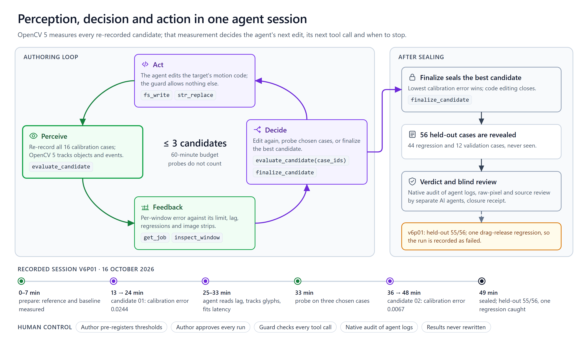

# Agentic Vision evidence — KiroClops

Supplement to the technical report for the Agentic Vision Award. It shows, from a recorded session, that OpenCV 5 output changes what the agent does next, and evaluates task success, failure handling, observability and human control. Workflow diagram: `diagrams/agent-loop.png` (system context: `diagrams/architecture.png`). Trace data: `evidence/agentic-trace-v6p01/` (extracted from the session's own audit log, SHA-256 of `kiro/tool-audit.jsonl` recorded in `trace.json`).

## 0. Award requirements and where they are met

| Requirement (official wording, abridged) | Where it is met |
|---|---|
| An agent uses OpenCV 5 tools within a multi-step perception, decision and action loop | Kiro CLI calls eight KiroClops MCP tools; each `evaluate_candidate` re-records the app and measures it with OpenCV 5 (§1, `diagrams/agent-loop.png`) |
| Image or video results influence a subsequent plan, tool call or action | Candidate 01's measured windows and timing offset led Kiro to write its own frame-tracking and latency-fit scripts, rewrite its input clock, probe three cases and call `evaluate_candidate` again (§2) |
| A developer-agent workflow qualifies only when it iteratively invokes, evaluates and adjusts an OpenCV 5 workload and culminates in a running image or video workload | Kiro invoked the OpenCV 5 measurement three times (two candidates and a cancelled probe), evaluated its output, adjusted the application that the workload measures, and sealed a candidate that was then re-recorded and measured on 56 held-out recordings |
| Using an AI coding assistant to write the entry does not qualify | Kiro does not write KiroClops. It is the agent inside the loop at run time, editing the user's application while KiroClops measures it. KiroClops itself was built with AI coding assistants, as the technical report discloses; that is not the claim here |
| Agent workflow diagram | `diagrams/agent-loop.png` |
| Trace showing that OpenCV 5 output changes a later decision, tool call or action | §2 and `evidence/agentic-trace-v6p01/` |
| Evaluation of task success, failure handling, observability and human control | §3 and §4 |

## 1. The loop

Perception: every `evaluate_candidate` call snapshots the agent's edited target, re-records all 16 calibration cases in headless Chromium and measures them with `kiroclops.visual` (OpenCV 5): object tracks, events and windowed comparison against pre-registered limits.
Decision: the agent reads the bounded feedback (per-window error against its limit, worse-than-baseline flags, lag, trajectories, paths of the candidate frames) and decides what to edit, whether to probe a subset of cases, or to finalize.
Action: the agent edits the motion source, calls `evaluate_candidate` again (full or `case_ids` probe), and finally `finalize_candidate`, which seals the candidate and reveals 56 held-out cases it never saw.

The agent may use any model; here it was Kiro CLI with `claude-opus-5.5`. The OpenCV workload is invoked through MCP (`kiroclops.local_engine.mcp`, eight tools), the measurement code is `kiroclops.visual`, and the same workload runs on the AWS Graviton4/COOL worker. Kiro is the agent inside the loop at run time, not the tool that wrote this entry; the claim is the measured feedback loop below.

## 2. Trace of the V6 panel session (`v6p01`, 16 October 2026)

230 audited tool calls (`inspect_session` 4, `prepare_experiment` 1, `evaluate_candidate` 3, `cancel_job` 1, `finalize_candidate` 1, `get_job` 126, `execute_pwsh` 61, `fs_write` 18, `str_replace` 7, `read_file` 6, `list_directory` 1, `tool_load` 1). Times are seconds from the first call.

| t (s) | step | what happened |
|---:|---|---|
| 7 | `prepare_experiment` | reference and unchanged baseline recorded and measured for 16 calibration cases (426 s) |
| 761 | `evaluate_candidate` (candidate 01) | first edit of `src/panel-motion.js` (+3/−1 lines) re-recorded and measured: eligible, calibration error **0.0244**, 102 windows all within limits but several near them |
| 1473–1677 | agent reads the OpenCV result | prints every window's error, limit and measured lag from the exported feedback (`windows.py`); tracks the bookmark and star glyphs in candidate 01's own exported frames (`track.py`); fits the per-input latency of its motion model to those tracks (`latfit.py`) |
| 1808–1971 | decision → code | rewrites `src/motion/spring.js`, adds `src/motion/input-clock.js`, rewrites `src/panel-motion.js` (+86/−15), builds a local node test, iterates twice |
| 1981 | `evaluate_candidate(case_ids=[...])` | partial probe on three cases, one from each recipe family added in V4/V5: reverse-wide 1280 (which held candidate 01's worst window, 0.85 of its limit), interrupt-early 768 and open-wide 1280 |
| 2163 | `cancel_job` + one more `str_replace` | cancels the probe after 151 s to apply a last fix, then |
| 2172 | `evaluate_candidate` (candidate 02) | full calibration: eligible, error **0.0067** (3.6× lower); worst window ratio drops from 0.85 to 0.43 |
| 2949 | `finalize_candidate` | candidate 02 sealed; 56 held-out cases measured (2,260 s): validation 12/12, regression 43/44 |

Evidence that the visual output drove the next tool call:

| candidate 01 feedback (top error/limit) | candidate 02 result |
|---|---|
| reverse-wide w1280, star, motion-0: 0.0427 / 0.0500 (0.85) | 0.0215 / 0.0500 (0.43) |
| interrupt-early w1280 r2, star, motion-1: 0.1077 / 0.1290 (0.83) | 0.0192 / 0.1290 (0.15) |
| reverse w960, handle, motion-0: 0.0388 / 0.0500 (0.78) | 0.0078 / 0.0500 (0.16) |
| interrupt-wide w1280 r2, star, motion-0: 0.0435 / 0.0594 (0.73) | 0.0040 / 0.0594 (0.07) |

In candidate 01 these windows also carried a measured lag of about −10 ms (KiroClops reports `lag_s` per window); in candidate 02 it is 0. The agent's own scripts show how it used the visual evidence: `windows.py` reads that lag, `track.py` measures glyph centroids in the candidate's frames, and `latfit.py` fits input latency to those tracks. The code diffs (`evidence/agentic-trace-v6p01/*.diff`) show the response: a new input-clock model and a re-tuned spring, a change to timing and dynamics. The probe is a spot check across the three new recipe families, not a ranking of the worst cases; only one of the three probed cases is among the five worst windows.

## 3. Task effectiveness and evaluation

* Calibration error improved from 0.0244 to 0.0067 across two candidates within the 60-minute authoring budget.
* **Against a no-agent baseline.** The unchanged app the agent started from was measured on the same recordings. The table scores it with the same formula as the candidates (mean of the per-window errors per case, then over cases). This is a post-hoc recomputation from the recorded per-window errors, `evidence/v6-agent-baseline/result.json` at the repository root; the formula reproduces every recorded candidate score exactly.

  | | unchanged app | candidate | candidate better on |
  |---|---:|---:|---:|
  | calibration, candidate 01 | 0.0502 | 0.0244 | 15 of 16 cases |
  | calibration, candidate 02 | 0.0502 | 0.0067 | 16 of 16 cases |
  | held-out, sealed candidate 02 | 0.0500 | 0.0121 | 53 of 56 cases |

* **Beyond this session.** `v6p01` is the case study with the most detailed trace. All 13 Kiro sessions logged between 1 and 16 October (7 web panel, 6 game; 1,135 audited tool calls) were read back the same way, post-hoc and read-only, with every recorded score reproduced exactly (`evidence/agent-sessions/REPORT.md`):

  | across the 13 logged sessions | result |
  |---|---|
  | sessions in which a candidate was measured | 11 (two ended before any candidate: an operator interruption and a request timeout) |
  | candidates closer to the reference than the unchanged app on calibration | 17 of 17 |
  | sessions in which the second candidate, written after the feedback, lowered the error | 5 of 6 (by 5% to 73%); in `v2g01` the mean error rose while more cases passed (6/12, then 9/12) |
  | sessions that reached sealed held-out scoring | 7; the sealed candidate was closer to the reference than the unchanged app in all 7, and on 308 of 326 held-out cases |
  | sessions in which every held-out case passed | 1 of 7 (`v4g01`, the accepted game run) |

  These are 13 single runs under recipes and gates that changed between versions, not a controlled experiment; panel and game errors are in different units, and the unchanged app is a no-agent reference, not a competing agent. They show that this case study is typical: the measured feedback is followed by an edit that usually lowers the error, and the sealed held-out set is what still finds the failures.
* The sealed candidate passed 55 of 56 held-out comparisons. The one failure is a genuine regression: after a drag release at 1,440 px Kiro's panel springs back toward where the drag started, while the reference and the unchanged app travel on to the other side (post-release position error 0.78–0.86 against limits of 0.05–0.076; 0.005–0.006 before the change). The calibration set has no drag-release case; the held-out set exists to catch exactly this, and it did. The run is therefore recorded as **failed** under the pre-registered rule, and the panel domain is not accepted.
* Across the project the same loop produced the accepted game and SVG results (technical report §6): game regression 48/48 and validation 30/30; SVG 28/28 windows with 112 raw records independently reviewed.

## 4. Failure handling, observability, security and human control

* **Budgets and refusal**: three full candidates, a frozen wall clock, a separate validation clock; an evaluation that the measured duration cannot fit is refused (`budget_insufficient`) instead of started and killed. Partial probes never count as candidates and cannot be finalized.
* **Recording failures**: a host timing stall re-records only the affected scenario; failed attempts are kept beside the canonical one; a stalling host is refused before any recording starts. Every attempt is in the job result.
* **Observability**: every tool call is logged by the guard before it runs (`kiro/tool-audit.jsonl`); every job has `job.json`, `result.json`, a worker log with tracebacks, and the full feedback JSON in the workspace; `inspect_window` renders reference/candidate/difference strips and an error-over-time plot on demand (available, but not called in any of the 13 logged sessions; a window-alignment defect in it was found and fixed after the freeze, technical report §6.4).
* **Security boundary**: the guard limits writes to the motion files and a scratch folder, denies session folders, parent traversal and control files, and closes writes and shell after sealing. In `v6p01` the guard allowed all 230 calls; the agent never attempted a denied path. Across the 13 logged sessions it refused 5 of 1,135 calls: three accesses to the CLI's own tool-output files outside the experiment folder (two file reads and one shell command), one shell command on a path outside the boundary and one file deletion. It is a cooperative boundary, not an OS sandbox; the post-run native audit replays Kiro's own logs against pinned envelope rules and matches them one-to-one with the guard decisions. The pinned rules cover kiro-cli 2.27.x; this run used 2.31.0 and is reported as native-uncertified.
* **Human control**: recipes and thresholds are pre-registered and hash-bound; held-out cases open only after sealing; results are never rewritten; a rerun gets a new identifier; the user decides every session start, every power-removal window and every post-hoc label. Acceptance of a domain requires independent raw review and source review by AI reviewer agents that never see production coordinates; no human pixel review is claimed (technical report, §6.1).

## 5. Files

* `evidence/agentic-trace-v6p01/trace.json` — timeline (230 calls, arguments summarised), five jobs with scores and failing windows, candidate diff statistics, audit SHA-256.
* `evidence/agentic-trace-v6p01/candidate-0{1,2}-*.diff` — the agent's code changes against the unchanged baseline.
* `evidence/agentic-trace-v6p01/agent-scratch/` — the helper scripts the agent wrote during the run (`windows.py`, `track.py`, `latfit.py`, `fit3.py`, `sim.py`) and its draft `input-clock.js`, copied unchanged from the session workspace.
* Held-out outcome per case: `evidence/panel-v6p01/heldout-outcome.json` (repository root).
* No-agent baseline, per case: `evidence/v6-agent-baseline/result.json` (repository root).
* All 13 logged sessions, per session and per candidate, with the source files and their SHA-256: `evidence/agent-sessions/REPORT.md` and `result.json` (repository root), produced by `scripts/agent_sessions_posthoc.py`.
* Internal sources, available on request: session `C:/kc3d/s/v6p01` (frozen); run log and receipts `artifacts/phase4-v6/v6p01-logs`, `artifacts/phase4-v6/kiro-power-window-05`.
